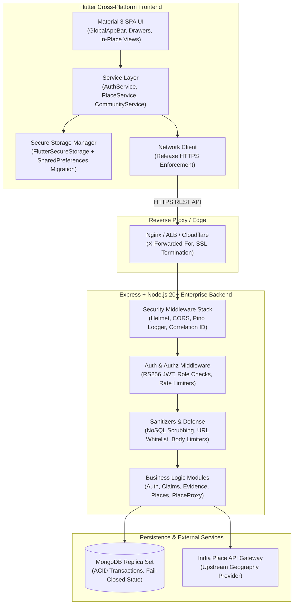

# My Root 🌱

> **स्थानीय ज्ञान का संरक्षण** | Preserving Local Knowledge

A multilingual, community-driven platform for preserving and verifying local history, folklore, opinions, and knowledge — organized by geographic hierarchy across India.

---

## 🏛️ System Architecture



---

## 📁 Repository Layout

```
My Root/
├── .github/
│   └── workflows/
│       └── ci.yml               # GitHub Actions CI for backend and frontend
├── backend/                     # Node.js 20+, Express, TypeScript, Mongoose
│   ├── src/                     # Core application source
│   ├── tests/                   # 25 test suites (400 tests, 100% passing)
│   ├── Dockerfile               # Multi-stage production container
│   ├── .dockerignore
│   ├── .env.example             # Complete configuration reference
│   └── README.md                # Backend architecture & security guide
├── frontend/                    # Flutter 3.x / Dart 3.x client application
│   ├── lib/                     # Application source, widgets, and services
│   ├── test/                    # 144 unit and widget tests (100% passing)
│   ├── pubspec.yaml             # Dependencies including flutter_secure_storage: ^9.2.2
│   └── README.md                # Frontend architecture & security guide
├── docs/                        # Architecture, requirements, policies
├── Dockerfile                   # Root Dockerfile build context
├── .dockerignore
└── README.md
```

---

## 🔒 Security Hardening & Defenses

### Backend Hardening (Remediated & Verified)
1. **Living-Person Biography Consent**: Strictly gates unreviewed biographical claims from search queries and public feed listings until verified consent is recorded.
2. **Fail-Closed DB Verification**: Authentication routes actively verify MongoDB connection status and fail closed with HTTP 503 (`SERVICE_UNAVAILABLE`) if the database is unreachable.
3. **NoSQL Injection Scrubbing**: Attribute query objects are sanitized recursively to strip `$where`, `$gt`, and other MongoDB operators.
4. **URL Scheme Whitelist**: Evidence URLs are validated against a strict protocol whitelist (`http://` and `https://` only) to block SSRF and protocol manipulation.
5. **Role-Enforced Dispute Authorization**: Claim dispute endpoints verify contributor rights and prevent unauthorized self-disputes.
6. **Unreviewed Attribute Gating**: Public place requests only return reviewer-verified attributes, preventing unreviewed user data leakage.
7. **Uniform Registration Response**: Registration yields an identical HTTP 201 response regardless of whether an account exists, eliminating account enumeration.
8. **Constant-Time Login Verification**: An email miss during login triggers a cost-12 bcrypt dummy hash comparison to eliminate timing discrepancies.
9. **RS256 JWT Primary Authentication**: Asymmetric RS256 token verification is enforced; HS256 HMAC fallback is strictly blocked in production.
10. **Route-Specific Payload Limits**: Ingestion endpoints enforce strict body size caps (100KB auth, 500KB claims, 10MB evidence).
11. **Gateway Secret Hardening**: Place API gateway forbids default placeholder secrets in production and strips unexpected query parameters.
12. **Structured Logging & Correlation IDs**: Pino logger tags requests and responses with `X-Correlation-ID` for distributed tracing.

### Frontend Hardening
- **Secure Native Token Storage**: Migrated JWT access/refresh token storage to `flutter_secure_storage: ^9.2.2` with transparent migration from `SharedPreferences`.
- **Complete Storage Purge**: Session logout purges credentials and profiles from both secure storage and SharedPreferences.
- **HTTPS Release Enforcement**: `AppConstants.sanitizeApiUrl` rejects insecure HTTP URLs in release mode (`kReleaseMode`), throwing a `StateError`.

---

## ⚙️ Environment Variables Reference

| Variable | Target | Default | Description |
|----------|--------|---------|-------------|
| `NODE_ENV` | Backend | `development` | Runtime environment (`development`, `test`, `production`) |
| `PORT` | Backend | `3001` | Express HTTP server port |
| `TRUST_PROXY` | Backend | `false` | Reverse proxy trust configuration (`loopback`, `1`, etc.) |
| `MONGODB_URI` | Backend | *Required* | MongoDB connection URI (replica set required) |
| `JWT_ISSUER` | Backend | `myroot-backend` | Expected token issuer |
| `JWT_AUDIENCE` | Backend | `myroot-platform` | Expected token audience |
| `JWT_ALLOW_HS256_FALLBACK` | Backend | `false` | Allow HS256 fallback if RSA keys are absent (dev only) |
| `JWT_PRIVATE_KEY_PATH` | Backend | `keys/private.pem` | RSA private key file path |
| `JWT_PUBLIC_KEY_PATH` | Backend | `keys/public.pem` | RSA public key file path |
| `JWT_ACCESS_SECRET` | Backend | *Required* | Fallback access secret (min 32 chars) |
| `JWT_REFRESH_SECRET` | Backend | *Required* | Fallback refresh secret (min 32 chars) |
| `RATE_LIMIT_WINDOW_MS` | Backend | `900000` | Global rate limit window in ms (15 min) |
| `RATE_LIMIT_MAX` | Backend | `100` | Global max requests per window |
| `AUTH_RATE_LIMIT_WINDOW_MS` | Backend | `900000` | Auth rate limit window in ms (15 min) |
| `AUTH_RATE_LIMIT_MAX` | Backend | `20` | Auth max requests per window |
| `CORS_ORIGINS` | Backend | `http://localhost:3000` | Comma-separated allowed CORS origins |
| `PLACE_API_PROXY_ENABLED` | Backend | `true` | Enable upstream India Place API proxy |
| `PLACE_API_BASE_URL` | Backend | `http://localhost:4001` | Upstream Place API URL |
| `PLACE_API_APP_GATE_SECRET` | Backend | *Optional* | Gateway secret (min 32 chars, cannot be placeholder in prod) |
| `PLACE_API_TIMEOUT_MS` | Backend | `5000` | Gateway request timeout in ms |

---

## 🧪 Test Execution & Verification

### Backend Verification
```bash
cd backend
npm run lint          # ESLint (0 errors, 0 warnings)
npm test              # Full test suite (25 suites, 400 tests passing)
npm run test:coverage # Coverage report
```

### Frontend Verification
```bash
cd frontend
flutter analyze       # Static analysis (0 issues found)
flutter test          # Full test suite (144 tests passing)
```

---

## 🐳 Containerization

Build and run the backend multi-stage production Docker image:

```bash
docker build -t my-root-backend -f backend/Dockerfile backend/
docker run -d -p 3001:3001 --env-file backend/.env my-root-backend
```
The image runs on Alpine Linux with `USER node`, supervises signals using `dumb-init`, and executes automated health checks at `/health`.
